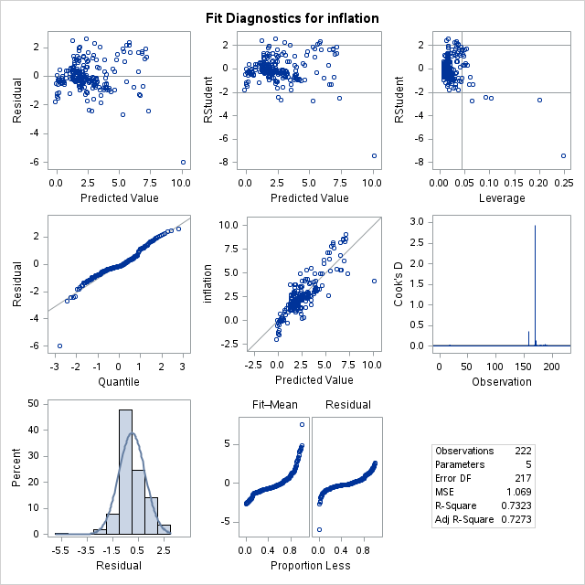
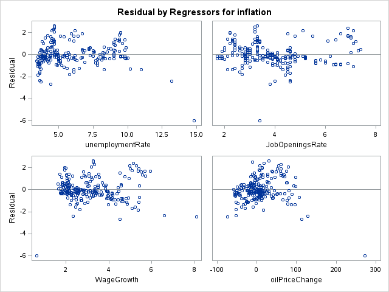

# How Labor Market Conditions Affect Inflation

Alexander Quintano | Introduction to Econometrics, Roanoke College | Fall 2025

## Question

How much of U.S. inflation can be explained by labor market conditions, and does the data support the Phillips curve tradeoff between unemployment and inflation?

## Data

Monthly U.S. data from FRED and the BLS Job Openings and Labor Turnover Survey (JOLTS), March 2006 to August 2024 (222 months). Inflation, wage growth (average hourly earnings) and oil price change are 12-month percent changes; unemployment and job openings are rates.

| Variable | Description | Mean | Std Dev | Min | Max |
|---|---|---|---|---|---|
| inflation | CPI, 12-month % change | 2.52 | 1.98 | -1.96 | 9.00 |
| unemploymentRate | Unemployment rate (%) | 5.90 | 2.20 | 3.40 | 14.80 |
| JobOpeningsRate | JOLTS job openings rate (%) | 3.86 | 1.36 | 1.70 | 7.40 |
| WageGrowth | Average hourly earnings, 12-month % change | 3.13 | 1.17 | 0.63 | 8.10 |
| oilPriceChange | Oil price, 12-month % change | 7.69 | 41.99 | -74.08 | 272.93 |

## Model

OLS regression, estimated in SAS (PROC REG) and replicated exactly in Python (statsmodels):

inflation = b0 + b1 unemploymentRate + b2 JobOpeningsRate + b3 WageGrowth + b4 oilPriceChange + e

## Results

| Variable | Estimate | Std Error | t | p |
|---|---|---|---|---|
| Intercept | -3.967 | 0.515 | -7.70 | < .0001 |
| unemploymentRate | 0.288 | 0.047 | 6.18 | < .0001 |
| JobOpeningsRate | 0.816 | 0.089 | 9.18 | < .0001 |
| WageGrowth | 0.461 | 0.098 | 4.72 | < .0001 |
| oilPriceChange | 0.025 | 0.002 | 13.61 | < .0001 |

N = 222 | R-squared = 0.732 | Adj. R-squared = 0.727 | F(4, 217) = 148.39 | Root MSE = 1.03

**What it says**

- The four variables explain about 73% of the month-to-month variation in inflation, and all four are significant at p < 0.0001.
- A 1-point rise in the job openings rate is associated with inflation about 0.82 points higher, the largest labor market effect in the model. Tight hiring markets go with higher inflation.
- A 1-point rise in wage growth goes with inflation about 0.46 points higher.
- Oil matters a lot in practice: a one standard deviation move in oil prices (about 42%) goes with inflation about 1 point higher.
- **The surprise:** unemployment has a *positive* coefficient (0.29), the opposite sign from what the Phillips curve predicts. Holding job openings, wages and oil constant, higher unemployment went with higher inflation in this sample.

## Why the unemployment result runs against the Phillips curve

The sample covers two big supply shocks, the 2008 oil spike and COVID, when prices rose while unemployment was also high. Supply shocks push inflation and unemployment up together, which breaks the usual tradeoff. I compared this with 8 academic and Federal Reserve sources, which also describe a flatter and less stable Phillips curve since the 2000s.

## Diagnostics

- Residuals are roughly normal (Q-Q plot and histogram), apart from one large outlier.
- One observation has very high influence (Cook's D = 2.93): the April 2020 to April 2021 window, when oil prices rose 273% off the COVID crash. The next most influential is the window into that crash (oil down 74%).

## Robustness checks (added November 2026)

The original paper reported the baseline OLS model. I went back and tested how well it holds up (`analysis.py`).

| | (1) Baseline OLS | (2) Newey-West SEs | (3) Drop April 2020 | (4) Add COVID indicator |
|---|---|---|---|---|
| unemploymentRate | 0.288*** | 0.288** | 0.341*** | 0.179 |
| JobOpeningsRate | 0.816*** | 0.816*** | 0.955*** | 0.722*** |
| WageGrowth | 0.461*** | 0.461* | 0.335 | 0.268 |
| oilPriceChange | 0.025*** | 0.025*** | 0.029*** | 0.022*** |
| covid (Mar 2020 to Dec 2021) | | | | 1.228 |
| R-squared | 0.732 | 0.732 | 0.786 | 0.743 |

\*\*\* p < 0.01, \*\* p < 0.05, \* p < 0.10. Columns 2 to 4 use Newey-West standard errors with 12 lags.

**What changed**

- **The residuals are strongly autocorrelated** (Durbin-Watson = 0.31, where 2 means none). That is expected with overlapping 12-month changes, and it means the original standard errors were too small. With Newey-West standard errors, the coefficients are the same but about 3 times less precise.
- **Job openings and oil hold up in every version.** They are the robust findings.
- **Wage growth does not.** It drops to marginal significance with corrected standard errors and loses significance in columns 3 and 4.
- **The positive unemployment coefficient is partly a COVID story.** It survives corrected standard errors and dropping the outlier, but once the model controls for the COVID period it shrinks to 0.18 and is no longer significant. That supports the supply-shock explanation in the paper.

## Limitations

- Wages, job openings and inflation affect each other, so these are associations, not causal effects.
- The 12-month changes overlap month to month, which is the main source of the autocorrelation. A next version could use non-overlapping or lagged changes.
- In the spreadsheet, most 12-month changes run forward from each month (for example, the March 2006 value is March 2006 to March 2007), but the last 12 rows were entered as values. Their timing should be checked against the same convention.

## Files

- `data/olsData.csv`: the dataset (222 months)
- `analysis.py`: Python replication and robustness checks (`pip install pandas statsmodels`, then `python analysis.py`)
- `figures/`: diagnostic plots from the original SAS run
